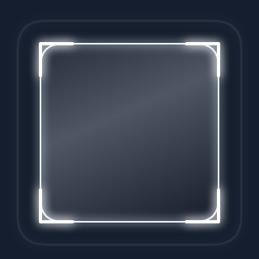
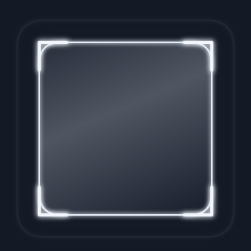
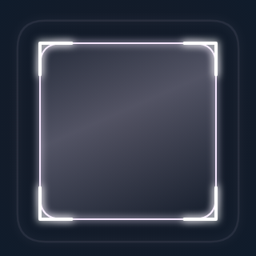
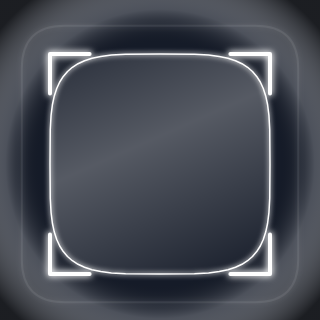
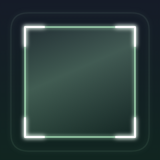
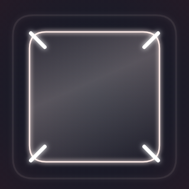

# qr_scan_fx

A premium, canvas-drawn QR-scanner overlay for Flutter: focus frames, corner
brackets, scan beams, spring-driven lock-on, and success/error bursts — all
themed, all composable from small layers, and all built on a single ticker and a
single `CustomPaint`.

`qr_scan_fx` is a **renderer, not a scanner**. It never owns the camera, never
decodes anything, and never sees QR content. It takes **geometry only** — a
bounding box or four corner points — and returns pixels.

<p align="center">
  
  
  
  
</p>

<p align="center">
  <em>Scanning → locked → success in the dark theme, then banking mode.</em>
</p>

---

## Table of contents

- [Why it exists](#why-it-exists)
- [Install](#install)
- [Quick start](#quick-start)
- [API at a glance](#api-at-a-glance)
- [Two ways to drive it](#two-ways-to-drive-it)
- [Keeping geometry aligned with the preview](#keeping-geometry-aligned-with-the-preview)
- [Lifecycle states](#lifecycle-states)
- [Themes](#themes)
- [Style vocabulary](#style-vocabulary)
- [The style gallery](#the-style-gallery)
- [Customizing the layer stack](#customizing-the-layer-stack)
- [Live tuning](#live-tuning)
- [Accessibility](#accessibility)
- [Banking mode](#banking-mode)
- [Security model](#security-model)
- [Performance](#performance)
- [FAQ](#faq)
- [Contributing](#contributing)
- [Requirements](#requirements)
- [Project layout](#project-layout)
- [Testing](#testing)
- [Documentation](#documentation)
- [Status](#status)

---

## Why it exists

Most scanner overlays are a `Container` with a border and a Lottie file. That
falls apart the moment a code is rotated, the preview is cropped, a front camera
mirrors the frame, or the sensor is mounted sideways.

This package treats the overlay as a rendering problem:

- **Geometry in, pixels out.** The only input is a `ScanFxTarget` (a rect or four
  corners, optionally normalized and mirrored/rotated). There is no API that
  accepts decoded text.
- **One rigid object.** Frame, corner brackets, beam and reticle all read the
  same animatable quadrilateral, so the lock-on reads as one shape rather than
  four layers chasing each other.
- **Composable styles.** Every style is a small class behind an enum, so any
  frame pairs with any bracket style, and a new style is one file plus one arm in
  the registry.
- **Cheap by construction.** One `Ticker` for the whole overlay, one
  `CustomPaint`, allocation-free `paint()`, and a ticker that stops whenever
  nothing is moving.

---

## Install

`qr_scan_fx` has **no runtime dependencies** beyond Flutter itself. The package
is not yet on pub.dev, so depend on it from a path or git ref:

```yaml
dependencies:
  qr_scan_fx:
    path: ../qr-scanner-effect
    # or:
    # git:
    #   url: https://github.com/qr-scan-fx/qr_scan_fx.git
```

Then:

```dart
import 'package:qr_scan_fx/qr_scan_fx.dart';
```

Bring your own camera. Examples below use
[`mobile_scanner`](https://pub.dev/packages/mobile_scanner), but any source that
can produce a bounding box or four corners works.

---

## Quick start

```dart
import 'package:flutter/material.dart';
import 'package:mobile_scanner/mobile_scanner.dart';
import 'package:qr_scan_fx/qr_scan_fx.dart';

class ScannerPage extends StatefulWidget {
  const ScannerPage({super.key});

  @override
  State<ScannerPage> createState() => _ScannerPageState();
}

class _ScannerPageState extends State<ScannerPage> {
  final QrScanFxController _controller = QrScanFxController();

  @override
  void dispose() {
    _controller.dispose();
    super.dispose();
  }

  void _onDetect(BarcodeCapture capture) {
    final Barcode? code = capture.barcodes.firstOrNull;
    if (code == null) return;

    final List<Offset>? corners = code.corners;
    _controller.lockOn(
      corners != null && corners.length == 4
          ? ScanFxTarget.corners(corners, normalized: true)
          : ScanFxTarget.rect(code.boundingBox!, normalized: true),
    );

    // Your decoder — not this package — decides what the code *means*:
    // _controller.success();   // or .error(msg) / .invalid(msg)
  }

  @override
  Widget build(BuildContext context) {
    return Scaffold(
      body: QrScanFx(
        controller: _controller,
        child: MobileScanner(onDetect: _onDetect),
      ),
    );
  }
}
```

Pass the camera preview as `child` and the overlay draws on top of it. When
`child` is omitted the overlay renders standalone over whatever is behind it,
which is what makes it testable and screenshot-able without a camera.

---

## API at a glance

Everything below is exported from `package:qr_scan_fx/qr_scan_fx.dart`. The
full reference is the dartdoc on each type.

| Type | What it is |
| --- | --- |
| `QrScanFx` | The overlay widget. Imperative (`controller:`) or declarative (`state:` + `detectedBounds:` / `detectedCorners:`), with `preset(...)` and `banking(...)` factories and `child`, `layers`, `onStateChanged` slots. |
| `QrScanFxController` | A `ChangeNotifier` + `ValueListenable<ScanFxState>`. `start()`, `lockOn(target)`, `success()`, `error([message])`, `invalid([message])`, `reset()`, `pause()` / `resume()`, `setTunables(...)`. Takes geometry, never text. |
| `ScanFxTarget` | The geometry that goes in: `.rect(...)` or `.corners(...)`, optionally `normalized` and mirrored. |
| `ScanGeometryMapper` | Maps a sensor-space target into widget space for `BoxFit.cover` / `contain`, with mirroring and quarter turns. |
| `QrScanFxTheme` | The `ThemeExtension` holding every colour, stroke, shape and style, plus 14 presets, `fromColorScheme`, `random`, `copyWith` and `lerp`. |
| `ScanFxTunables` | Runtime knobs (intensity, speed, glow, corner radius, beam thickness, blur) that change without resetting an animation. |
| `ScanFxMotion` / `ScanFxEasing` | The duration, curve and spring table, overridable per theme. |
| `ScanFxRecipes` / `ScanPreset` | The five one-line looks. |
| `ScanLayerStack` / `ScanLayerEntry` | The ordered layer list, with `insert`, `replace`, `remove`, `hide`, `show`. |
| `ScanLayer` / `CustomScanLayer` | The base class and the host-facing escape hatch for a bespoke painter. |
| `ScanFrameLayer`, `ScanCornerLayer`, `ScanBeamLayer`, `ScanBackdropLayer`, `ScanReticleLayer`, `ScanEffectLayer`, `ScanHintLayer` (+ `ScanHintView`) | The per-kind bases, for subclassing a style rather than writing one from scratch. |
| `ScanFxState` / `ScanFxStateMachine` / `ScanFxTrigger` | The lifecycle enum and the pure-Dart machine behind it, usable headless. |
| `ScanFxFrame` | The immutable per-tick snapshot every layer reads. |
| `ScanFxQuad` / `ScanFxShapes` | The animatable quadrilateral and the path maths on top of it. |
| `ScanFxIdleModifier` / `ScanFxIdleTransform` | The ambient-motion modifier contract. |
| `ScanFxSemanticsLabels` | The localisable spoken labels for each state. |
| `ScanFxPalette` | Colour helpers, including `ensureContrast`. |
| `ScanFxRegistry` | The enum-to-implementation mapping (the only place the two meet). |
| `ScanFxStatusNotice` | The default banking failure pill, used by `QrScanFx.banking`. |

---

## Two ways to drive it

### Imperative — recommended for a real camera

Hold a `QrScanFxController` and call it from wherever detections arrive:

```dart
final controller = QrScanFxController();

controller.lockOn(ScanFxTarget.corners(points, normalized: true));
controller.success();
controller.error('That code is not supported');
controller.invalid('Unsupported QR schema');
controller.reset();

controller.pause();   // freezes all motion, stops the ticker
controller.resume();
```

This is the right choice for a live feed: geometry changes many times a second
and the spring tracks it continuously. A repeated `lockOn` only refreshes the
geometry — it never restarts the lock-on hold, so an overlay driven by a 30 fps
detector still reaches `locked`.

The controller is both a `ChangeNotifier` and a
`ValueListenable<ScanFxState>`, so it works with `AnimatedBuilder`,
`ValueListenableBuilder` and the widget's `onStateChanged` callback.

### Declarative — recommended for tests and previews

Pass `state` (and optionally geometry) and let the widget do the calling:

```dart
QrScanFx(
  state: ScanFxState.locked,
  detectedBounds: const Rect.fromLTWH(0.25, 0.25, 0.5, 0.5),
  normalized: true,
  child: preview,
)
```

`state` is authoritative while it is non-null; setting it back to `null` leaves
the overlay wherever the controller last was. The two modes can be combined:
`state` decides the lifecycle while `detectedBounds` / `detectedCorners` keep the
quad tracking.

---

## Keeping geometry aligned with the preview

This is where scanner overlays usually break. Supply the sensor resolution and
the same fit mode your preview widget uses, and the package does the rest:

```dart
QrScanFx(
  controller: controller,
  sensorSize: const Size(1920, 1080), // the frame that produced the detection
  previewFit: BoxFit.cover,           // must match your preview widget
  flipX: true,                        // front-camera previews
  quarterTurns: 1,                    // sensor orientation vs. preview
  child: MobileScanner(controller: camera, fit: BoxFit.cover, ...),
)
```

- `normalized: true` — coordinates are `0..1` relative to the sensor frame
  (the usual case for web and for plugins that report relative bounds).
- `flipX` / `flipY` — bridge front-camera mirroring.
- `quarterTurns` (0–3) — bridge sensor rotation.
- `sensorSize` + `previewFit` — keep the overlay aligned with a cropped or
  letterboxed preview (`cover` and `contain` are both handled).

When `sensorSize` is omitted, detection coordinates are treated as already
living in overlay space.

The mapping is a pure, unit-tested function and is also public if you want to
draw your own geometry from the same numbers:

```dart
final mapper = ScanGeometryMapper(
  sensorSize: const Size(1920, 1080),
  overlaySize: const Size(390, 844),
);
final ScanFxQuad? quad = mapper.map(
  ScanFxTarget.corners(points, normalized: true),
);
```

Corners do not need to be ordered. They are sorted into a stable convex ring so
rotated and perspective-skewed codes frame exactly, and so the lock-on animation
never twists.

---

## Lifecycle states

```
idle ──► scanning ──► detected ──► locked ──► success
                        │            │
                        └────────────┴────────► error
                        └────────────┴────────► invalid
any ──► reset() ──► scanning
```

| State | Meaning |
| --- | --- |
| `idle` | No scan session started. Ambient motion only. |
| `scanning` | Session active, no target tracked. Beam is sweeping. |
| `detected` | A target was located; the focus animation is running. |
| `locked` | The focus settled. The steady "target acquired" state. |
| `success` | A successful read. |
| `error` | A read failed. |
| `invalid` | The code was read but the host refuses it. |

`detected` is **transient** with `autoLock: true` (the default): after a short
hold it promotes itself to `locked`. Set `autoLock: false` to keep `detected`
sticky and drive the transition yourself. `success`, `error` and `invalid` hold
their final frame until `reset()` or a new `lockOn()`.

Levelling the transition rules is a pure Dart state machine
(`ScanFxStateMachine`), importable and testable without pumping widgets. Illegal
transitions are ignored rather than thrown, so a noisy detector can never crash a
host app.

`pause()` / `resume()` are orthogonal to state: they freeze the tickers and keep
the last frame, and `isPaused` is exposed as a separate listenable.

---

## Themes

`QrScanFxTheme` is a `ThemeExtension`, so it can be installed app-wide and
overridden per widget. Resolution order inside the overlay:

1. `QrScanFx(theme: ...)` — per-widget override wins.
2. `Theme.of(context).extension<QrScanFxTheme>()` — the app-wide theme.
3. `QrScanFxTheme.dark` / `QrScanFxTheme.light` — by ambient brightness.

```dart
MaterialApp(
  theme: ThemeData(
    extensions: const <ThemeExtension<dynamic>>[
      QrScanFxTheme.bankingBlue,
    ],
  ),
  // ...
);
```

Built-in themes and factories:

- `QrScanFxTheme.dark` — tuned for a camera preview at night (the default).
- `QrScanFxTheme.light` — tuned for bright environments and light shells.
- `QrScanFxTheme.bankingBlue` — calm, neutral, critically damped, every
  duration under 400 ms, neutral wording ("Code scanned").
- `QrScanFxTheme.fromColorScheme(scheme)` — derives a theme from a Material 3
  `ColorScheme`.
- `QrScanFxTheme.random(seed: 42)` — a deterministic palette for demos.

Every theme exposes color, stroke, shape, style, motion, tunable, typography and
semantics-label groups, with a full `copyWith`, value equality and `lerp`.
Colours created through `fromColorScheme` / `random` are passed through
`ScanFxPalette.ensureContrast`, so overlay text clears WCAG AA rather than hoping
for it.

```dart
QrScanFx(
  controller: controller,
  theme: QrScanFxTheme.dark.copyWith(
    cornerColor: Colors.amber,
    frameShape: ScanFrameShape.squircle,
    beamStyle: ScanBeamStyle.glowingLaser,
    motion: ScanFxMotion.banking,
  ),
)
```

---

## Style vocabulary

Styles are plain enums, which keeps themes `const`-friendly and makes exhaustive
switches (and therefore golden coverage) possible.

| Category | Values |
| --- | --- |
| Frame shape | `roundedSquare`, `squircle`, `circle`, `cornersOnly`, `hexagon`, `diamond`, `fullBorder`, `dashedBorder`, `viewfinderCross` |
| Corner brackets | `rounded`, `sharp`, `dot`, `chamfered`, `pill`, `doubleLine`, `glowing`, `animatedDraw` |
| Beam | `line`, `softGradientBar`, `glowingLaser`, `doubleLaser`, `radar`, `gridScan`, `dotMatrix`, `waveform`, `pulseRings`, `aurora`, `none` |
| Backdrop | `solidDim`, `blurredFrost`, `vignette`, `gradientFade`, `spotlight`, `none` |
| Lock-on | `springSnap`, `smoothMorph`, `zoomIn`, `pulseLock`, `ringContract`, `scanlineSweepOver`, `particleBurst`, `glitchLock`, `none` |
| Success | `checkMorph`, `colorWash`, `glowFlash`, `rippleWaves`, `confetti`, `cornersFlash`, `none` |
| Error | `shake`, `redPulse`, `fadeBlink`, `glitch`, `crossMorph`, `none` |
| Idle motion | `breathing`, `floating`, `shimmer`, `still` |

That is **60 styles across 8 families** (`none` included so every family has a
switch-off value).

`frameShape` and `cornerStyle` are independent layers, so a `circle` frame can
pair with `sharp` brackets. Idle motion is a *modifier* applied to the shared
quad rather than a layer, so it can never conflict with a frame style.

Finer control lives in option objects on the theme — `ScanBackdropOptions`,
`ScanBeamOptions`, `ScanLockOptions`, `ScanSuccessOptions`, `ScanErrorOptions`:

```dart
theme: QrScanFxTheme.dark.copyWith(
  beam: const ScanBeamOptions(
    direction: ScanBeamDirection.diagonal,
    motion: ScanBeamMotion.pingPong,
    period: Duration(milliseconds: 1800),
    thickness: 3.5,
    trail: 0.4,
    glow: 0.8,
  ),
  lock: const ScanLockOptions(padding: 16, cornerFollow: 0.85),
  backdrop: const ScanBackdropOptions(feather: 22, dimOpacity: 0.6),
)
```

---

## The style gallery

Every combination of the eight families is supported, and the styles are
independent by design — a hexagon frame with `chamfered` brackets and an `aurora`
beam is a valid theme, not a special case.

| | |
| --- | --- |
|  **`cyberpunk`** |  **`appleVision`** |
|  **`retroLaser`** |  **`playfulPop`** |

The five recipes are one-liners:

```dart
QrScanFx.preset(ScanPreset.cyberpunk, controller: controller)
```

…and can be tweaked like any other theme by going through the plain
constructor:

```dart
QrScanFx(
  controller: controller,
  theme: ScanFxRecipes.theme(ScanPreset.appleVision).copyWith(
    cornerStyle: ScanCornerStyle.animatedDraw,
  ),
)
```

To browse the whole surface without writing a demo, run the **Style Studio** in
`example/`: it puts every family on a segmented control and updates the overlay
live, so a look can be found by clicking rather than recompiling.

---

## Customizing the layer stack

The overlay is drawn as an ordered stack. The default order is:

```
backdrop → frame → corners → beam → reticle → success → error → hint
```

The `layers` builder receives the default stack and may reorder, hide, replace or
extend it. Every mutator returns a **new** immutable stack.

```dart
QrScanFx(
  controller: controller,
  layers: (context, stack) => stack
      .hide(ScanLayerKind.hint)
      .replace(ScanLayerKind.beam, MyBeam())
      .insert(3, CustomScanLayer(MyPainter(), layerKind: ScanLayerKind.reticle)),
  child: preview,
)
```

To write your own visuals, subclass `ScanLayer` (one class per style):

```dart
class MyBeam extends ScanLayer {
  @override
  ScanLayerKind get kind => ScanLayerKind.beam;

  @override
  void paint(Canvas canvas, Size size, ScanFxFrame frame) {
    // Mutate cached Paint/Path objects — never allocate inside paint().
  }
}
```

Layers can also contribute a widget under the painter (`buildEffect`, used for a
real `BackdropFilter` frost) or above it (`buildOverlay`, used for the hint pill).
Host-facing text stays a widget so it inherits locale, text scaling and font
fallback from the host app for free.

---

## Live tuning

`ScanFxTunables` holds the knobs a host may want to change at runtime **without
resetting the animation** — the director picks them up on the next tick. Nullable
fields are overrides: `null` means "use the theme value".

```dart
controller.setTunables(
  controller.tunables.copyWith(intensity: 0.8, speed: 1.5, glow: 0.4),
);
```

| Knob | Range | Effect |
| --- | --- | --- |
| `intensity` | `0..1` | Scales alpha, glow and padding. |
| `speed` | `0.25..3` | Divisors every duration; current progress is preserved. |
| `glow` | `0..1` (or `null`) | Bloom strength; `0` removes the blur pass. |
| `cornerRadius` | px (or `null`) | Frame corner radius override. |
| `beamThickness` | px (or `null`) | Beam thickness override. |
| `blurSigma` | px (or `null`) | Frosted-backdrop blur; `0` degrades to a flat dim. |

`tunablesListenable` lets a host rebuild only when tuning changes. The same
values can be seeded per widget with `QrScanFx(tunables: ...)`.

---

## Accessibility

- **Reduce motion.** `MediaQuery.disableAnimationsOf(context)` is honored: the
  ambient loop stops, every duration is capped, springs settle in a few frames,
  and the same code path still runs — terminal effects render to their steady
  state instead of fading to nothing. State changes are still announced.
- **Screen readers.** The lifecycle state is exposed as a
  `Semantics(liveRegion: true, container: true)` whose label comes from the
  theme, so announcements are driven by the platform rather than by imperative
  calls — the variant that behaves consistently on Android and across windows.
- **Localizable copy.** All strings live in `ScanFxSemanticsLabels` on the theme;
  none are hardcoded in painters.
- **Directionality.** Beam direction and hint placement follow `TextDirection`,
  so RTL layouts mirror correctly.

---

## Banking mode

`QrScanFx.banking()` is the payment-shaped default: a neutral blue palette, a
soft beam, a critically damped lock-on, and **nothing loud** — no particles, no
glitch, no confetti, no neon. This is not a style you pass in; it is what the
theme *cannot express*, because a theme that names no loud style cannot render
one however it is driven, and every duration is capped below 400 ms.

```dart
final controller = QrScanFxController();

QrScanFx.banking(
  controller: controller,
  onRetry: () => controller.reset(),
  confirmationBuilder: (context) => const Text('Code captured'),
  controlsBuilder: (context) => Row(
    mainAxisSize: MainAxisSize.min,
    children: [
      IconButton(onPressed: toggleTorch, icon: const Icon(Icons.flashlight_on)),
      IconButton(onPressed: pickFromGallery, icon: const Icon(Icons.photo_library)),
    ],
  ),
)
```

| Seat | Appears when | Purpose |
|---|---|---|
| `confirmationBuilder` | `success` | Your own confirmation, in your own words |
| `messageBuilder` | `error` / `invalid` | The reason + retry (a `ScanFxStatusNotice` by default) |
| `controlsBuilder` | always | Torch, gallery, "enter code manually" |

Each builder is inserted as a direct child of the overlay's `Stack`, so wrap it
in `Align`/`Positioned`/`Padding` to place it. All three are optional.

### What `success` means

`controller.success()` means **the code was scanned**. It does not mean a payment
succeeded, was authorised, or was attempted. The package has no idea, and nothing
it renders will ever suggest otherwise — `confirmationBuilder` is where *you*
state *your* outcome. The package never triggers a payment, because it has no API
that could.

### Failure and retry

`controller.invalid('This merchant code is not supported')` sets the message and
moves the state. The default `messageBuilder` renders a `ScanFxStatusNotice`: a
calm pill carrying that copy plus a "Try again" button wired to `onRetry`. It is a
`ValueListenableBuilder`, so a rejection that lands *after* the state changed
still reaches the screen.

### Accessibility guarantees

The banking palette is checked in CI, not just asserted: text and every state
colour clear **4.5:1** against the backdrop (`ScanFxPalette.contrastRatio`), the
notice wraps instead of clipping under a `textScaler` of 2.0, and the entrance
animation is skipped when the platform requests reduced motion.

Payment-specific guidance — what belongs in `confirmationBuilder`, what must
*not*, and the exact boundary of the package's responsibility — lives in
[`doc/payment-qr-guide.md`](doc/payment-qr-guide.md).

---

## Security model

The package has **no** API that accepts, stores, or transmits a QR payload, and
this is enforced against the source rather than promised in prose.

**The boundary, in one line:** the host decodes; the package receives geometry
and returns pixels. Nothing else crosses.

- Public controller methods take `ScanFxTarget`, `Rect` or `List<Offset>` only.
  No method, field or parameter holds decoded text.
- The only strings the package can hold are host-supplied UI copy (`error` /
  `invalid` messages, hint text, semantics labels). They are treated as opaque,
  never logged, and cleared as soon as the state moves on.
- **No `dart:io`, no networking, no persistence, no analytics** anywhere in
  `lib/src/`. The published package declares exactly one dependency: the Flutter
  SDK. `mobile_scanner` is a **dev** dependency, used only by the dev-only demo
  entrypoint (`lib/main.dart`) — the one file that is allowed near a camera.
- `success()` means "the code was scanned" — never "the payment succeeded". Hosts
  own validation and any payment logic.

### How it is enforced

`test/scan_fx_security_test.dart` reads every file under `lib/src/` (and the
barrel) and fails if any of them:

- imports `dart:io`, `dart:isolate`, `dart:ffi`, `package:flutter/services.dart`,
  an HTTP client, a webview, a camera plugin or the Firebase SDK;
- references `MethodChannel` / `EventChannel` / `BinaryMessenger`, an
  `HttpClient`, a `Socket`, `Process`, `File`, or calls `print` / `debugPrint` /
  `developer.log`;
- contains the words `displayValue`, `rawValue`, `barcode`, `decodedText` or
  `payloadText` in code;
- or if `pubspec.yaml` grows a second runtime dependency.

The suite also pins that a controller constructed with no payload ever holds one,
and that only the dev entrypoint may reach the camera plugin. If a future change
opens the boundary, a test fails before a review does.

`doc/architecture.md` §11 carries the full rationale.

---


## Performance

- **Exactly one `Ticker`** for the whole overlay and **exactly one
  `CustomPaint`**, wrapped in a `RepaintBoundary`. The camera `child` is a sibling
  and is never rebuilt by our ticks.
- Layers read a shared immutable frame snapshot, so a tick repaints without
  rebuilding a single widget. Only *state* changes trigger a widget rebuild
  (a handful of times per scan, never per frame).
- **The ticker stops** when nothing is moving — in the terminal states once the
  burst is done, and for the whole duration of `pause()`.
- Layers declare `animated`; a stack of static layers stops ticking entirely.
- Cached `Paint` / `Path` / geometry live on the layer instances, which the
  overlay keeps alive across rebuilds, so `paint()` does not allocate in the
  steady state.
- The blur backdrop is the only expensive style. It is opt-in, and `blurSigma: 0`
  is the documented fast path that degrades to a flat dim.

---

## FAQ

**Does this package use the camera?**
No. It draws an overlay and nothing else. You supply geometry — a `Rect` or four
`Offset`s — from whatever detector you already trust (`mobile_scanner`, ML Kit,
`zxing`, a server, a test fixture). See [Security model](#security-model).

**Does the overlay ever see the decoded text?**
There is no parameter anywhere in the public API that accepts it. The rule is
enforced by `test/scan_fx_security_test.dart`, which reads every file under
`lib/src/` and fails if one mentions `rawValue`, `displayValue`, `barcode`,
`decodedText` or `payloadText`, imports a forbidden library, opens a channel or
calls `print`.

**Can I use it with `mobile_scanner`?**
Yes — that is what the bundled demo does. Feed
`BarcodeCapture.barcodes.first.corners` into
`controller.lockOn(ScanFxTarget.corners(corners, normalized: true))`; the
geometry mapper handles `BoxFit.cover` / `contain`, mirroring, quarter turns and
rotated targets.

**Why is `mobile_scanner` only a dev dependency?**
Because the package must not require a camera. It ships zero runtime dependencies
besides the Flutter SDK; the demo host and the examples pull the camera in.

**How do I stop the overlay from animating?**
It already does when it can: the ticker stops in terminal states once the burst
finishes and for the whole duration of `pause()`. To stop *visually*, respect
reduce motion (which the package honours automatically) or set the idle motion to
`ScanIdleStyle.still` and the beam to `ScanBeamStyle.none`.

**Is it accessible?**
`MediaQuery.disableAnimations` is honoured by rendering effects to their steady
state rather than skipping transitions, so no state is lost. The lifecycle is a
`Semantics(liveRegion: true)` with labels from `ScanFxSemanticsLabels`, and
directions follow `TextDirection`. `QrScanFxTheme.bankingBlue` keeps body text at
4.5:1 or better and survives a 2.0 text scale.

**Can I add my own style?**
You don't extend the enums — they are closed so switches stay exhaustive.
Instead, insert a `CustomScanLayer` (or a subclass of one of the layer bases)
into the stack with `ScanLayerStack.insert` / `.replace`. That is how the built-in
styles are written.

**Does it work on web and desktop?**
Yes. It is pure Dart/Flutter with no platform channels, and it is tested on
Android, iOS, web, macOS, Windows and Linux.

---

## Contributing

Contributions are welcome. Before opening a pull request:

```bash
dart format .
flutter analyze          # also run inside example/
flutter test
```

Style rules that are not optional here:

- **One style per file.** A new style is a small class plus one arm in
  `ScanFxRegistry`; keep it that size.
- **No allocation in `paint()`.** Reuse cached `Paint`/`Path`/geometry; the frame
  snapshot is immutable and shared.
- **Nothing reads QR content.** The security test is the gate, not review.
- **Every style needs coverage.** The registry tests paint every value in every
  state; the visual tests assert that each family draws and that no two values in
  a family render the same picture.
- **Documentation is part of the change.** Public API needs dartdoc; behaviour
  changes update `doc/` and `CHANGELOG.md`.

Regenerate the pub.dev screenshots after a visual change:

```bash
flutter test tool/generate_screenshots.dart
```

---

## Requirements

- Dart SDK `>=3.4.0 <4.0.0`
- Flutter `>=3.19.0`
- No platform channels, no camera dependency in the package itself.

---

## Project layout

```
lib/
  qr_scan_fx.dart              # the public surface (exports only)
  src/
    animation/                 # the director + the per-tick frame snapshot
    controller/                # QrScanFxController
    geometry/                  # targets, quads, shapes, sensor→overlay mapper
    layers/                    # the layer system and every concrete style
      backdrop/ frame/ corners/ beam/ reticle/ effects/ idle/ hint/
      paint/                   # shared Paint/Path/glow caches
    physics/                   # springs, curves, timed values
    state/                     # ScanFxState + the pure Dart state machine
    theme/                     # ThemeExtension, styles, motion, tunables, labels
    widget/                    # the QrScanFx widget + ScanFxStatusNotice
  main.dart                    # dev-only camera host (the runnable demo)
example/                       # the demos, all driven through the public API
  lib/main.dart                # a chooser for the four demos
  lib/style_studio.dart        # every frame, corner, beam and effect, live
  lib/banking_demo.dart        # a calm payment flow, scripted (no camera)
  lib/banking_camera_demo.dart # the full flow: camera, torch, gallery, KHQR
  lib/scanner/                 # the camera screen, split into small widgets
  lib/payment/                 # KHQR parsing, confirmation, receipts, history
  lib/theme.dart               # the demos' own Material theme
  test/                        # tests for the KHQR and receipt logic
test/                          # widget, state-machine, registry, visual, banking,
                               #   recipe and security tests
tool/
  generate_screenshots.dart    # renders screenshots/ for the pub.dev page
screenshots/                   # the generated previews (committed)
doc/
  architecture.md              # layering, data flow, performance, security
  animation-spec.md            # the timing and spring spec
  payment-qr-guide.md          # using the overlay in a payment flow
```

`example/lib/payment/khqr.dart` is worth reading on its own: it is the *host's*
half of the boundary — it parses an EMVCo/KHQR payload into a merchant, an
amount and a currency, and never hands the payload to the overlay.

The public API is re-exported from `lib/qr_scan_fx.dart`. Importing that file is
all a host needs.

---

## Testing

```bash
flutter analyze          # also run inside example/
flutter test             # the package suite
(cd example && flutter test)   # the example's own tests
```

The suite covers the full `idle → … → reset` lifecycle, repeated detections not
restarting the hold, declarative state reporting and geometry, rotated /
mirrored / quarter-turned targets, reduce motion, controller swapping, pause /
resume, custom layer reordering, every registry style mapping, every preset and
recipe, the banking seats (confirmation, invalid message, retry, controls),
4.5:1 banking contrast, 2.0 text scale, and the security boundary — which is
checked against the source rather than promised, in
`test/scan_fx_security_test.dart`.

`test/scan_fx_visual_test.dart` rasterises the layer stack and asserts *derived*
facts — every style draws (or is provably inert), no two values in a family render
the same picture, every preset is distinct — instead of comparing to committed
goldens, which cannot survive a platform change.

---

## Documentation

- [`doc/architecture.md`](doc/architecture.md) — goals, package layout, data
  flow, state machine, layer system, theme model, security boundary, performance
  budget and testing strategy.
- [`doc/animation-spec.md`](doc/animation-spec.md) — the motion language:
  durations, curves and springs, and the reasoning behind each number.
- [`doc/payment-qr-guide.md`](doc/payment-qr-guide.md) — using the overlay in a
  payment flow: the host/package boundary, the confirmation slot, failure and
  retry, and a security checklist.
- The library doc comment in `lib/qr_scan_fx.dart` is the entry point to the API
  reference.

---

## Status

Version `0.1.0`. The overlay, controller, state machine, theme system, layer
registry, geometry mapper and banking mode are implemented and covered by tests.
The repository ships a runnable camera demo (`lib/main.dart`), three camera-free
examples under `example/`, the three design documents under `doc/`, screenshots
under `screenshots/`, and a release `CHANGELOG.md` and `LICENSE`.

The package is ready to publish; it is not on pub.dev yet.

`qr_scan_fx` is a renderer with a deliberately narrow contract. If your selector
is a better `CustomPainter` than a `BorderRadius` can express, or if a payment
flow needs a calm overlay that provably never touches the payload, that narrow
contract is the whole point.
